<div align="center">

[🇧🇷 Português](./README.md) &nbsp;|&nbsp; 🇺🇸 English

<br>


<br><br>

[](https://www.linkedin.com/in/nathan-jr-588b1638b)
[](https://github.com/nathanjrdev)


</div>

<br>

## 👋 About me

I'm a **Computer Engineering** student at **UNASP** (Brazil) and an intern in **CI&T's Next Gen AI** program, where I build software with AI every day.

I like taking generative AI into real products: semantic search, tool-calling agents and **MCP** integrations. Before code, I worked in **IT support** at UNASP's administration and I teach computer basics to kids at **Projeto Alphabit (ADRA)**. That taught me to start with the people who will use the system.

```python
from dataclasses import dataclass, field

@dataclass
class NathanJr:
    degree: str = "Computer Engineering @ UNASP (2024 → 2029)"
    now: str    = "Next Gen AI Intern @ CI&T"
    focus: list = field(default_factory=lambda: [
        "LLMs and tool-calling agents",
        "RAG, embeddings and semantic search",
        "MCP and Agent Skills",
        "AI evaluation with real metrics",
    ])
    certifications: int = 10         # 7 from the Claude track (Anthropic)

    def philosophy(self) -> str:
        return "AI is software: it needs tests, metrics and clear limits."
```

<br>

## 🤖 Featured project: Léia

> **🚧 In progress · v1 due Nov 14, 2026**

**Léia** is an AI assistant for book rentals. Readers chat in plain Portuguese ("a short thriller for the weekend") and she searches the catalog, checks stock at each branch, prices the rental and books it, always asking for confirmation first.

The point isn't the chat: it's **proving with numbers that the agent gets it right**.

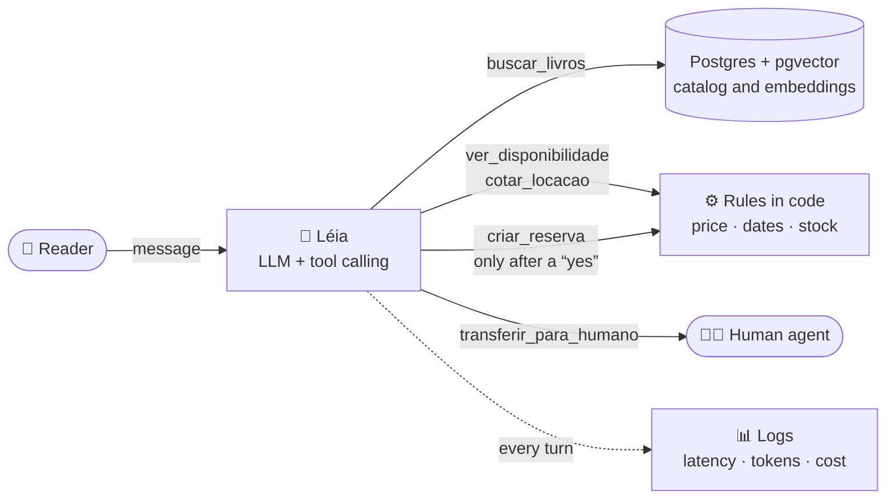

| Principle | How Léia applies it |
|:--|:--|
| The model never makes up numbers | Price and stock always come from tools |
| Nothing is written without confirmation | Bookings and cancellations only after the reader says "yes" |
| Evaluation as software testing | Search Recall@5, tool accuracy and cost per conversation in the README |

<br>

## 🧪 AI Repositories

<table>
<tr>
<td width="50%" valign="top">

**🤖 Léia**
AI assistant for book rentals: understands plain-language requests, searches the catalog, checks stock and books the rental with confirmation.

`Python` `FastAPI` `Postgres` `pgvector` `Tool calling`

🚧 In progress · v1 on Nov 14

</td>
<td width="50%" valign="top">

**🧮 Semantic Embeddings**
Full embeddings pipeline: chunking, vector generation (VoyageAI), L2 normalization, PCA and cosine-similarity search.

`Next.js` `VoyageAI` `TypeScript`

✅ Done · [View project →](https://github.com/nathanjrdev/Embeddings-semanticos-dashboard)

</td>
</tr>
<tr>
<td width="50%" valign="top">

**🖥️ pixel-dev-office**
Pixel-art office that turns Claude Code agents at work into animated characters in the browser.

`HTML` `JavaScript` `Pixel Art`

✅ Done · [View project →](https://github.com/nathanjrdev/pixel-dev-office)

</td>
<td width="50%" valign="top">

**🤗 PT-BR embeddings model**
Fine-tuned multilingual embeddings model for Portuguese requests, published on Hugging Face with before/after metrics.

`Hugging Face` `Fine-tuning` `Embeddings`

📋 Planned

</td>
</tr>
</table>

<br>

## 🚀 Other projects

<table>
<tr>
<td width="50%" valign="top">

**🃏 Flashlingo**
English-learning app with spaced repetition (SM-2), 5 screens and native pronunciation audio.

`Mobile/web app` `SRS` `SM-2`

[View project →](https://github.com/nathanjrdev/Flashlingo)

</td>
<td width="50%" valign="top">

**🌱 Smart Garden**
IoT system: soil moisture, temperature and water sensors trigger irrigation on their own.

`IoT` `Sensors` `Automation`

[View project →](https://github.com/nathanjrdev/PROJETO-HORTA-INTELIGENTE)

</td>
</tr>
<tr>
<td width="50%" valign="top">

**🩺 MedicPlan**
Medical planning SaaS, built with the modern front-end ecosystem.

`Next.js` `TypeScript` `SaaS`

[View project →](https://github.com/nathanjrdev/SAAS-medicplan)

</td>
<td width="50%" valign="top">

<sub>See the full list in my <a href="https://github.com/nathanjrdev?tab=repositories">repositories</a>.</sub>

</td>
</tr>
</table>

<br>

## 🛠️ Stack

**Languages**


**Frameworks & back-end**


<sub>REST APIs · Microservices · JWT · Automated testing</sub>

**Tools**


**AI & LLMs**


<sub>Tool calling · Agent Skills · RAG · Embeddings · Semantic search · PCA · LLM evaluation</sub>

<br>

## 🎓 Certifications

<div align="center">


</div>

<sub>Click a thumbnail to open the full certificate.</sub>

<table>
<tr>
<td align="center" width="25%">
<a href="assets/certs/pdfs/mcp-advanced.pdf">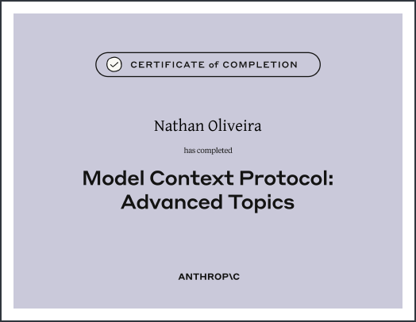</a>
<br><sub><b>MCP: Advanced Topics</b><br>Anthropic · Jul/2026</sub>
</td>
<td align="center" width="25%">
<a href="assets/certs/pdfs/mcp-intro.pdf">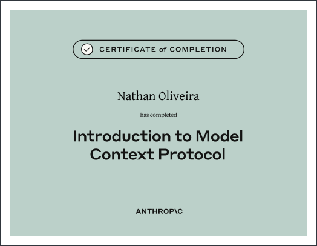</a>
<br><sub><b>Introduction to MCP</b><br>Anthropic · Jul/2026</sub>
</td>
<td align="center" width="25%">
<a href="assets/certs/pdfs/agent-skills.pdf">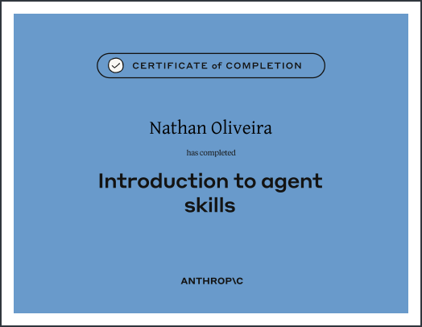</a>
<br><sub><b>Introduction to Agent Skills</b><br>Anthropic · Jul/2026</sub>
</td>
<td align="center" width="25%">
<a href="assets/certs/pdfs/claude-api.pdf">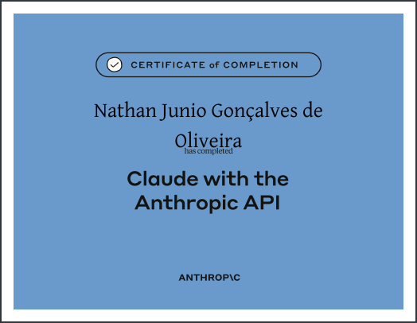</a>
<br><sub><b>Building with the Claude API</b><br>Anthropic · Jul/2026</sub>
</td>
</tr>
<tr>
<td align="center" width="25%">
<a href="assets/certs/pdfs/claude-code.pdf">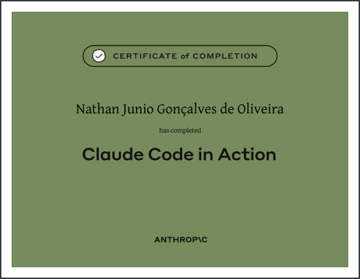</a>
<br><sub><b>Claude Code in Action</b><br>Anthropic · Jul/2026</sub>
</td>
<td align="center" width="25%">
<a href="assets/certs/pdfs/claude-101.pdf">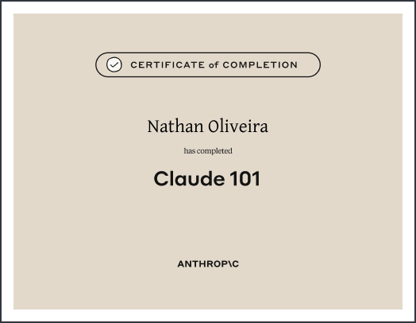</a>
<br><sub><b>Claude 101</b><br>Anthropic · Jun/2026</sub>
</td>
<td align="center" width="25%">
<a href="assets/certs/pdfs/ai-fluency.pdf">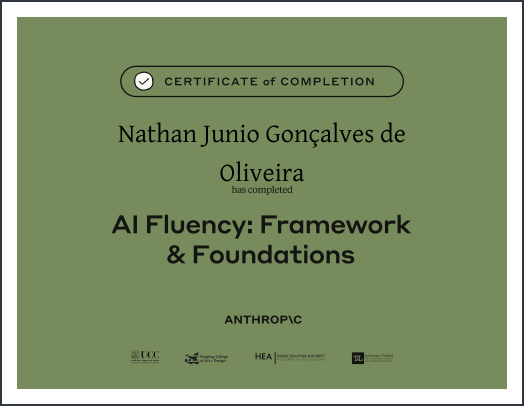</a>
<br><sub><b>AI Fluency: Framework & Foundations</b><br>Anthropic · Aug/2026</sub>
</td>
<td align="center" width="25%">
<a href="assets/certs/pdfs/cit-bootcamp.pdf">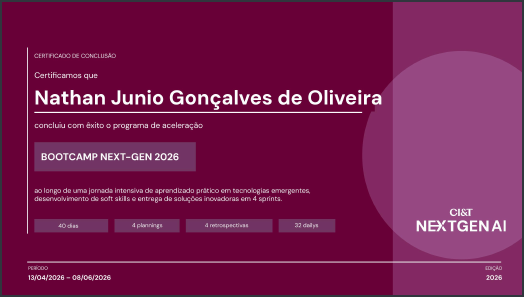</a>
<br><sub><b>Bootcamp Next-Gen 2026</b><br>CI&T · Apr/2026</sub>
</td>
</tr>
<tr>
<td align="center" width="25%">
<a href="assets/certs/pdfs/rocketseat-java.pdf">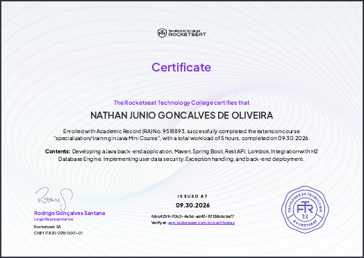</a>
<br><sub><b>Java Minicourse</b><br>Rocketseat · Sep/2026</sub>
</td>
<td align="center" width="25%">
<a href="assets/certs/pdfs/rocketseat-docker.pdf">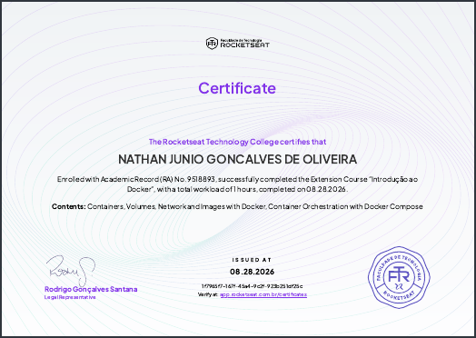</a>
<br><sub><b>Intro to Docker</b><br>Rocketseat · Aug/2026</sub>
</td>
<td align="center" width="25%">
<a href="assets/certs/pdfs/impacta-java.pdf">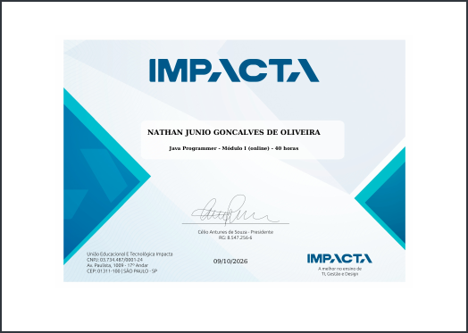</a>
<br><sub><b>Java</b><br>Impacta</sub>
</td>
<td width="25%"></td>
</tr>
</table>

<br>

## 🟡 Contributions

<div align="center">

<picture>
  <source media="(prefers-color-scheme: dark)" srcset="https://raw.githubusercontent.com/nathanjrdev/nathanjrdev/output/pacman-contribution-graph-dark.svg">
  <source media="(prefers-color-scheme: light)" srcset="https://raw.githubusercontent.com/nathanjrdev/nathanjrdev/output/pacman-contribution-graph.svg">
  
</picture>

<sub>generated with <a href="https://github.com/abozanona/pacman-contribution-graph">abozanona/pacman-contribution-graph</a></sub>

</div>
