<div align="center">

🇧🇷 Português &nbsp;|&nbsp; [🇺🇸 English](./README.en.md)

<br>


<br><br>

[](https://www.linkedin.com/in/nathan-jr-588b1638b)
[](https://github.com/nathanjrdev)


</div>

<br>

## 👋 Sobre mim

Sou estudante de **Engenharia da Computação no UNASP** e estagiário no programa **Next Gen AI da CI&T**, onde desenvolvo software com IA no dia a dia.

Gosto de levar IA generativa para produtos reais: buscas semânticas, agentes que chamam ferramentas e integrações via **MCP**. Antes do código, passei pelo **suporte técnico da Reitoria do UNASP** e dou aulas de informática para crianças no **Projeto Alphabit (ADRA)**. Isso me ensinou a olhar primeiro para quem vai usar o sistema.

```python
from dataclasses import dataclass, field

@dataclass
class NathanJr:
    curso: str  = "Engenharia da Computação @ UNASP (2024 → 2029)"
    agora: str  = "Estagiário Next Gen AI @ CI&T"
    foco: list  = field(default_factory=lambda: [
        "LLMs e agentes com tool calling",
        "RAG, embeddings e busca semântica",
        "MCP e Agent Skills",
        "avaliação de IA com métricas reais",
    ])
    certificacoes: int = 10          # 7 delas na trilha Claude (Anthropic)

    def filosofia(self) -> str:
        return "IA é software: precisa de teste, métrica e limites claros."
```

<br>

## 🤖 Projeto em destaque: Léia

> **🚧 Em construção · v1 prevista para 14/11/2026**

A **Léia** é uma assistente de IA para locação de livros. O leitor conversa em linguagem natural ("um suspense curto para o fim de semana"), e ela busca no catálogo, confere o estoque de cada unidade, calcula o valor e fecha a reserva, sempre pedindo confirmação antes.

O diferencial não é o chat: é **provar com números que o agente acerta**.

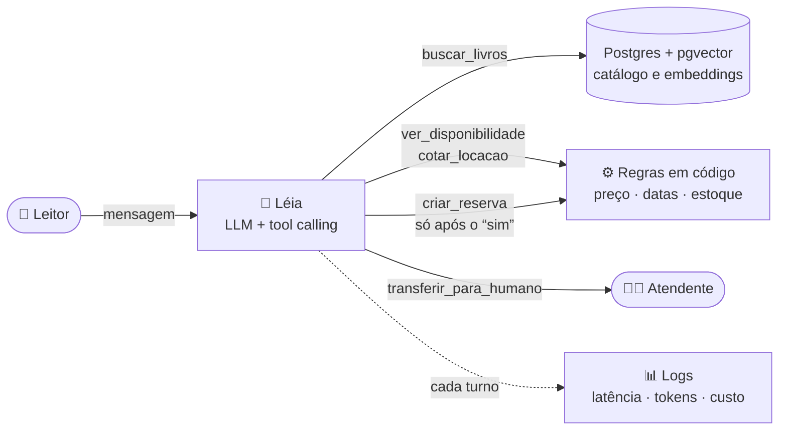

| Princípio | Como a Léia aplica |
|:--|:--|
| O modelo não inventa números | Preço e estoque vêm sempre das ferramentas |
| Nada é gravado sem confirmação | Reserva e cancelamento só depois do "sim" do leitor |
| Avaliação como teste de software | Recall@5 da busca, acerto de ferramenta e custo por conversa no README |

<br>

## 🧪 Repositórios de IA

<table>
<tr>
<td width="50%" valign="top">

**🤖 Léia**
Agente de IA para locação de livros: entende pedidos em linguagem natural, busca no catálogo, confere estoque e fecha a reserva com confirmação.

`Python` `FastAPI` `Postgres` `pgvector` `Tool calling`

🚧 Em construção · v1 em 14/11

</td>
<td width="50%" valign="top">

**🧮 Embeddings Semânticos**
Pipeline completo de embeddings: chunking, geração de vetores (VoyageAI), normalização L2, PCA e busca por similaridade de cosseno.

`Next.js` `VoyageAI` `TypeScript`

✅ Pronto · [Ver projeto →](https://github.com/nathanjrdev/Embeddings-semanticos-dashboard)

</td>
</tr>
<tr>
<td width="50%" valign="top">

**🖥️ pixel-dev-office**
Escritório em pixel-art que transforma agentes do Claude Code trabalhando em personagens animados no navegador.

`HTML` `JavaScript` `Pixel Art`

✅ Pronto · [Ver projeto →](https://github.com/nathanjrdev/pixel-dev-office)

</td>
<td width="50%" valign="top">

**🤗 Modelo de embeddings PT-BR**
Ajuste fino de um modelo multilíngue de embeddings para pedidos em português, publicado no Hugging Face com métricas de antes e depois.

`Hugging Face` `Fine-tuning` `Embeddings`

📋 Planejado

</td>
</tr>
</table>

<br>

## 🚀 Outros projetos

<table>
<tr>
<td width="50%" valign="top">

**🃏 Flashlingo**
App de inglês com repetição espaçada (algoritmo SM-2), 5 telas e áudio de pronúncia nativa.

`App mobile/web` `SRS` `SM-2`

[Ver projeto →](https://github.com/nathanjrdev/Flashlingo)

</td>
<td width="50%" valign="top">

**🌱 Horta Inteligente**
Sistema de IoT: sensores de umidade, temperatura e água acionam a irrigação automaticamente.

`IoT` `Sensores` `Automação`

[Ver projeto →](https://github.com/nathanjrdev/PROJETO-HORTA-INTELIGENTE)

</td>
</tr>
<tr>
<td width="50%" valign="top">

**🩺 MedicPlan**
SaaS de planejamento médico, construído com o ecossistema moderno de front-end.

`Next.js` `TypeScript` `SaaS`

[Ver projeto →](https://github.com/nathanjrdev/SAAS-medicplan)

</td>
<td width="50%" valign="top">

<sub>Veja a lista completa nos meus <a href="https://github.com/nathanjrdev?tab=repositories">repositórios</a>.</sub>

</td>
</tr>
</table>

<br>

## 🛠️ Stack

**Linguagens**


**Frameworks e back-end**


<sub>APIs REST · Microsserviços · JWT · Testes automatizados</sub>

**Ferramentas**


**IA e LLMs**


<sub>Tool calling · Agent Skills · RAG · Embeddings · Busca semântica · PCA · Avaliação de LLMs</sub>

<br>

## 🎓 Certificações

<div align="center">


</div>

<sub>Clique em uma miniatura para abrir o certificado completo.</sub>

<table>
<tr>
<td align="center" width="25%">
<a href="assets/certs/pdfs/mcp-advanced.pdf">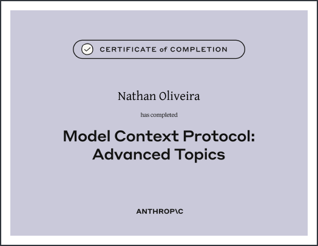</a>
<br><sub><b>MCP: Advanced Topics</b><br>Anthropic · Jul/2026</sub>
</td>
<td align="center" width="25%">
<a href="assets/certs/pdfs/mcp-intro.pdf">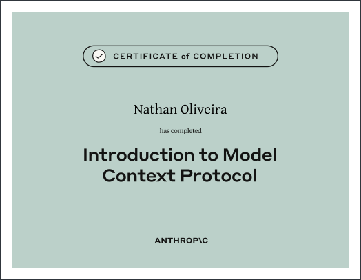</a>
<br><sub><b>Introduction to MCP</b><br>Anthropic · Jul/2026</sub>
</td>
<td align="center" width="25%">
<a href="assets/certs/pdfs/agent-skills.pdf">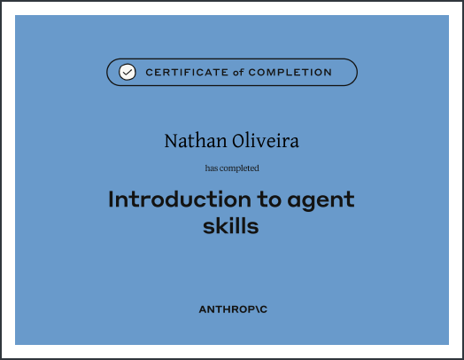</a>
<br><sub><b>Introduction to Agent Skills</b><br>Anthropic · Jul/2026</sub>
</td>
<td align="center" width="25%">
<a href="assets/certs/pdfs/claude-api.pdf">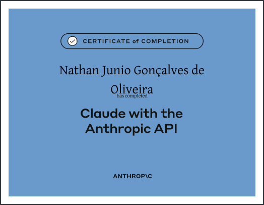</a>
<br><sub><b>Building with the Claude API</b><br>Anthropic · Jul/2026</sub>
</td>
</tr>
<tr>
<td align="center" width="25%">
<a href="assets/certs/pdfs/claude-code.pdf">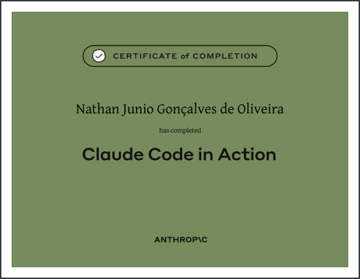</a>
<br><sub><b>Claude Code in Action</b><br>Anthropic · Jul/2026</sub>
</td>
<td align="center" width="25%">
<a href="assets/certs/pdfs/claude-101.pdf">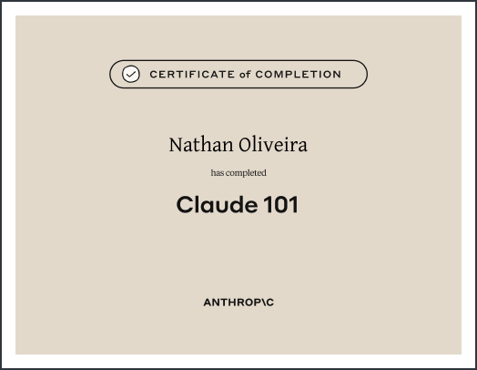</a>
<br><sub><b>Claude 101</b><br>Anthropic · Jun/2026</sub>
</td>
<td align="center" width="25%">
<a href="assets/certs/pdfs/ai-fluency.pdf">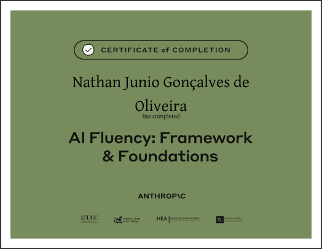</a>
<br><sub><b>AI Fluency: Framework & Foundations</b><br>Anthropic · Ago/2026</sub>
</td>
<td align="center" width="25%">
<a href="assets/certs/pdfs/cit-bootcamp.pdf">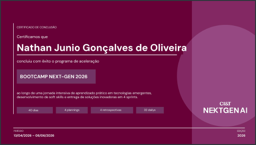</a>
<br><sub><b>Bootcamp Next-Gen 2026</b><br>CI&T · Abr/2026</sub>
</td>
</tr>
<tr>
<td align="center" width="25%">
<a href="assets/certs/pdfs/rocketseat-java.pdf">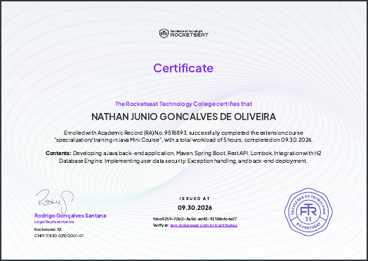</a>
<br><sub><b>Minicurso de Java</b><br>Rocketseat · Set/2026</sub>
</td>
<td align="center" width="25%">
<a href="assets/certs/pdfs/rocketseat-docker.pdf">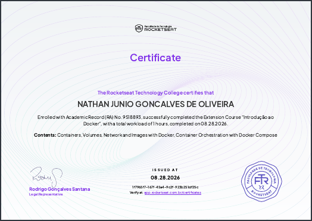</a>
<br><sub><b>Introdução ao Docker</b><br>Rocketseat · Ago/2026</sub>
</td>
<td align="center" width="25%">
<a href="assets/certs/pdfs/impacta-java.pdf">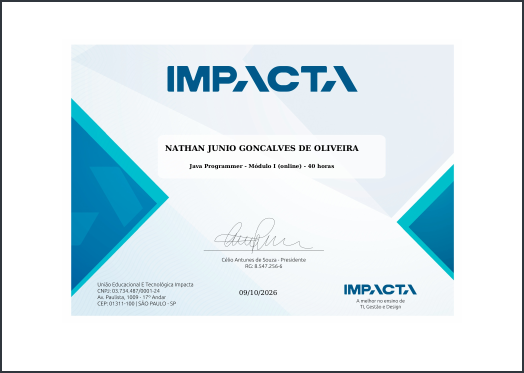</a>
<br><sub><b>Java</b><br>Impacta</sub>
</td>
<td width="25%"></td>
</tr>
</table>

<br>

## 🟡 Contribuições

<div align="center">

<picture>
  <source media="(prefers-color-scheme: dark)" srcset="https://raw.githubusercontent.com/nathanjrdev/nathanjrdev/output/pacman-contribution-graph-dark.svg">
  <source media="(prefers-color-scheme: light)" srcset="https://raw.githubusercontent.com/nathanjrdev/nathanjrdev/output/pacman-contribution-graph.svg">
  
</picture>

<sub>gerado com <a href="https://github.com/abozanona/pacman-contribution-graph">abozanona/pacman-contribution-graph</a></sub>

</div>
